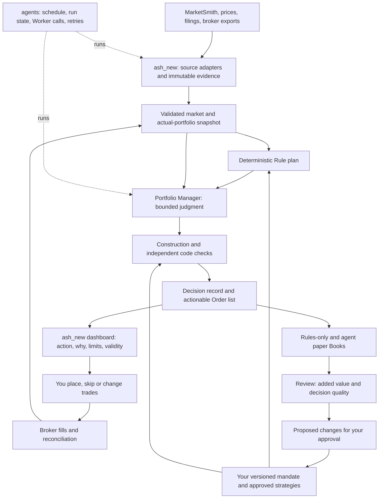

# Consolidating ash_backend and ash_new before the Portfolio Manager

Research and design proposal · 25 October 2026 · Saransh

## Read this first

**Make ash_new the single portfolio platform. Move ash_backend's useful data collection and decision primitives into it progressively. Keep `agents` responsible for running the Pipeline and calling Workers. Add a portfolio-construction layer between approved strategies and the actual Order list.**

The Portfolio Manager should answer: **“Given my approved strategies, what I actually own, today's market, and my limits, what should I do now—and why?”** A strategy shortlist is one input to that answer.

Your decisions in this conversation establish the product's direction:

- The agent makes bounded decisions automatically; you place the trades.
- The objective is better returns with drawdown kept within your limits.
- Decisions must use the data you can inspect and strategic terms you understand.
- Strategies and the parameters governing discretion require your approval.

This means in-mandate buys, sizing, holds, deferrals, rotations and exits can become an Order list without a separate approval round for each recommendation. Changing the mandate, enabling an unapproved strategy, or extending discretion remains your decision. Placing an order and recording a fill remain distinct from deciding to trade.

**The research supports this architecture; it does not establish that an LLM will improve your returns.** Drawdown limits are actionable controls and evaluation criteria, not a guarantee against gaps, illiquidity or delayed manual execution. The agent must earn its role against an implementable rules-only portfolio after costs.

This is a proposal, not a migration or an activated trading system. No running services, portfolio data, approved strategies or existing PRDs were changed. The companion [research memo](D:/Saransh/agents/docs/research/portfolio-consolidation-evidence.md) contains the primary-source evidence and its limitations.

## 1. What exists today

The inspection covered local source files, selected tests, domain documents and existing issues in all three repositories. It did not inspect live broker accounts, production Supabase data, credentials or running schedules, and did not execute the applications or test suites. “Implemented” below means code exists, not that production behavior was verified. Runtime configuration may differ from defaults.

| Area | ash_backend | ash_new / portfolio-dashboard | Consolidation decision |
|---|---|---|---|
| MarketSmith | Fetchers, normalizers, raw storage, Supabase metrics | Reads ash's raw files into securities, fundamentals and current ratings | Preserve collection; move its ownership to ash_new behind a source adapter |
| Prices and market data | OHLC caches and historical research artifacts | Lake, panels, corporate actions, index membership, benchmarks, freshness/health machinery | Lake becomes the decision authority; preserve original raw archives |
| Strategies | Screens, backtest engines and risk overlays | Versioned rules, baskets, native Python plugins, backtests and live tracks | ash_new becomes the active strategy registry and engine |
| Actual portfolios | Supabase transactions, aggregated positions, FIFO reporting | SQLite portfolios/transactions, real and paper ledgers, imports, NAV, actions | Migrate and reconcile into one canonical ledger before changing the writer |
| Decision logic | Implemented breadth → slots → exit flags → LLM enrichment → PM_BUY alerts | Deterministic sizing, costs, drift/order proposals, portfolio following | Reuse suitable pure functions; build one Book-level construction and validation path |
| Stops and alerts | Dynamic TRADE_LIMIT stops, ratchets, regime influence, alert publishing | Strategy exits and trading simulation | Give protective stops, strategy exits and discretionary exits explicit separate purposes; one publisher per purpose |
| User surface | Admin panel and Sash/Supabase integration | Strategy research and portfolio dashboard | ash_new becomes the main review and execution surface; retain a compatibility projection if Sash is still used |
| Scheduling | Job chains including portfolio manager and publication | Daily refresh, API scheduler, Windows task support | One scheduled entry point through `agents`; internal jobs remain callable |
| Agent runtime | Structured LLM call in the backend manager | No inspected Book-level discretionary manager | `agents` calls the Worker; ash_new owns facts, mandate, validation and committed decisions |

Sources: [C1–C10](#code-evidence). This arrangement consolidates responsibilities first. It does not require merging Git histories or replacing SQLite with a new service.

### Findings that change the migration plan

1. **Several ash strategies are already ported.** ash_new includes CW2, Aim & Shoot, GFS, HAMA, Investor, Momentum, RS Rating, Super30 and Swing plugins. Tests compare ported signals with copied ash reference functions. Treat the earlier “port ash strategies” issue as an inventory/parity task before assuming it needs fresh implementation. [C4]
2. **A port is not the identical investment product.** CW2 documents next-open execution versus ash's same-close convention, different costs and benchmark handling, and later parameter changes. Super30 documents unavailable fund-holder history and the handling of that missing input. Record these differences as named strategy versions and evidence caveats; do not inherit an old backtest's approval by name. [C4]
3. **ash_new still depends on ash's files.** Its default `ash_data_dir` points to the sibling repository; MarketSmith adapters consume `raw/MS/<region>/latest`; a separate adapter bootstraps prices from ash caches. Moving a folder without replacing these contracts would break ingestion. [C2, C3]
4. **The older manager is real code, not just a PRD.** It gathers holdings and candidates, computes breadth and slots, adds LLM judgment, publishes PM_BUY alerts and persists a review. The code's degraded LLM path retains deterministic buys, whereas ADR-0011 describes skipping judgment-dependent buy ranking. Migration must follow observed code and deliberately resolve the desired fallback. [C1]
5. **Current regime and scheduling semantics need an explicit replacement.** `read_regime` does not enforce freshness. `run_all` runs `sync_supabase` before the manager writes the new regime. This can make a stop update depend on an earlier run's regime. A run-bound, timestamped input removes the ambiguity. [C6]
6. **Health checks currently follow paper updates.** ash_new's daily chain runs `live` before `health`, and `live` updates strategy tracks and following paper portfolios. Put a validation boundary before any new managed Book decisions/fills are committed. Existing research tracks can be retained as provisional artifacts until validated. [C7]
7. **The future stocks Pipeline is largely a documented plan in this checkout.** The inspected `agents` tree contains the daily Pipeline, while stocks functionality is in the PRD/issues. Its runner proceeds through later Steps after failures, so each decision/publication Step needs explicit prerequisite checks. A successful report Step cannot imply a valid trading decision. [C8]
8. **Approval semantics conflict across plans.** ash_new's pending actions expire; the stocks PRD says Answers never expire. Keep Answers permanently as historical records, but make an actionable order valid only for its specified session/state. Old assent must not reactivate an obsolete trade. [C9]
9. **Raw retention documentation has drifted.** ash_backend's README describes pruning old runs; current raw-storage code describes retaining per-run archives and a cumulative `latest`. Base retention/migration work on the implementation and an actual archive inventory, not that README description. [C10]

## 2. The simplified future setup

The system has three owners:

| Owner | Owns | Boundary |
|---|---|---|
| **ash_new portfolio core** | Facts, strategies, actual holdings, approved mandate, construction, validation, decision records, attribution | All portfolio mutations pass through its typed commands and transaction checks |
| **Portfolio Manager Agent** | Judgment among permitted alternatives, evidence requests, reasons, review hypotheses | Can read scoped snapshots and submit a decision proposal; cannot edit facts, limits, strategy code or filled transactions |
| **agents runtime** | When Steps run, Worker selection, resumable run artifacts, time/cost budgets and status | Does not recreate holdings, portfolio math or risk rules in TypeScript |

Keep one Python application with internal modules initially. Introduce `mandates`, `books`, `decisions`, `evidence`, and `execution` modules as needed alongside the existing Lake, strategies and portfolios. These are proposed boundaries, not names of existing modules. Reuse the current SQLite app database and immutable file artifacts; DuckDB/Parquet remain suitable for analytical data. Add transactional tables and migrations for decisions, orders and events. A distributed queue, microservices, vector database or several competing managers would add operations before the core behavior is proven.

### Move, keep, retire

| Component | Transition | End state |
|---|---|---|
| ash MarketSmith fetchers/processors | Wrap existing code with a documented output manifest; compare normalized output before moving | Source modules owned by ash_new; private source credentials stay in the adapter |
| ash raw archives | Inventory, copy with hashes, preserve source/fetch timestamps; switch paths only after checks | Immutable source evidence plus a rebuildable latest view |
| ash strategy engines | Freeze as migration references; compare signals and explain execution differences | ash_new versions are authoritative; old engines remain archived research artifacts |
| ash breadth, slots, discipline, stop functions | Extract useful pure behavior with parity fixtures; remove assumptions about sentinel users and Supabase symbols | Tested functions consuming canonical security IDs and approved policies |
| ash PM_BUY and stop publishers | Keep one active writer during transition; new manager shadow-only | One authoritative publication path; no duplicate advice or competing stop updates |
| Supabase/Sash | Determine which screens and writers are still used; preserve existing migration ownership | Optional one-way projection of committed decisions and holdings, with source IDs and watermarks |
| ash_new dashboard | Add decision and execution views to existing portfolio pages | One place to inspect facts, actions, explanations and performance |
| Static Stocks Brief | Render from the same decision record | Optional offline report; it never becomes a second decision/approval database |
| `agents` stocks Pipeline | Implement small typed Steps using ash_new commands | Sole scheduled driver, with explicit prerequisites and persistent run state |

Sash's Supabase schema has a documented migration owner in the Flutter repository. Do not duplicate that history in ash_new. If the Flutter app continues accepting transactions, its writes must enter the same canonical ingestion path or be disabled at cutover; a one-way projection alone cannot reconcile two live writers. This dependency needs an inventory, not an assumption that the mobile app is obsolete. [C11]

## 3. Define what “manage it as I would” means

A Mandate specifies **what is allowed**. An investing playbook specifies **how to choose among allowed actions**. Approved strategies specify **where eligible opportunities and mechanical exits come from**. Keep these distinct and versioned.

### Mandate: executable limits and authority

Capture these as typed fields with units, scope, effective time, version and approval provenance:

| Group | Required content |
|---|---|
| Objective | Return benchmark, total-return convention, evaluation horizon, drawdown objective and breach procedures |
| Capital and scope | Books/accounts, market/currency, available cash, settlement rules, withdrawals, kept holdings and their exposure treatment |
| Exposure | Name/sector/theme limits, portfolio exposure and cash bands, allowed instruments, leverage/shorting restrictions |
| Strategies | Approved immutable version IDs, eligible candidate sets, Sleeve budgets, Stages and retirement behavior |
| Discretion | Allowed actions and reasons; sizing range; timing window; cash range; within-Sleeve substitution rules; limits on deviation from the Rule plan |
| Execution | Trade-value/liquidity limits, minimum trade size, turnover budget, whole-share/lot rules, allowed order types, price tolerance, validity session |
| Protection | Mandatory exits, protective-stop policy, drawdown triggers, re-entry/recovery conditions and contingency behavior |
| Data | Freshness requirements by input, required evidence, uncertainty handling and reconciliation tolerance |
| Governance | Who changes each field, effective version, revocation, fallback authority and review schedule |

The existing stocks PRD records 15% name and 30% sector caps, no new buys at 10% drawdown, reduced exposure at 18%, a 25% drawdown objective, and other parameters. **Preserve these as previously documented settings to reconcile into the executable Mandate; this research does not silently replace them or newly approve them.** Define whether drawdown uses a cash-flow-adjusted Book NAV, which high-water mark applies, and the recovery rule. Clarify whether “halve exposure” means a target relative to pre-trigger exposure or the strategic allocation. [C12]

For kept holdings, define both the exposure numerator and denominator. Show managed-Book exposure and total-account concentration separately where their scopes differ. A kept position may block another purchase even when the manager cannot sell it. That is an explainable infeasibility, not permission to bypass the cap.

### Playbook: bounded judgment in familiar language

Start with your actual decision vocabulary: breakout quality, extension from a base, relative strength, earnings risk, market breadth, distribution, thesis intact/broken, correlated holdings, cash opportunity cost and whether a rotation improves the Book.

For each concept, record observable inputs, approved interpretation, permitted actions, counterevidence and a review horizon. Example: “When an eligible breakout is extended and earnings are near, start smaller or defer within the timing window; do not invent a new entry outside the approved strategy.” The exact thresholds and action range belong in your approved playbook.

Use historical decisions and new prospective examples to calibrate preferences. Ask you to choose between concrete alternatives, record the information available at that time and why you preferred one, and reserve examples for evaluation. Separate “resembles Saransh's choices” from “improves net outcomes.” A model can imitate a mistake faithfully. Neither a compelling Journal entry nor a successful trade updates the playbook automatically.

### Discretion should be bounded, not restricted to subtraction

| Action | Agent can decide automatically when… | Requires your policy decision when… |
|---|---|---|
| Buy or add | Candidate is strategy-eligible; its Stage, size range, cash and portfolio limits permit it | New strategy/universe, increased risk budget, or eligibility exception |
| Size smaller or larger than baseline | Within the approved deviation range; whole-Book checks pass | Outside that range or changes strategy/Sleeve allocation policy |
| Hold / defer | Within approved timing and hold rules; mandatory exits are respected | It would delay a mandatory exit or exceed a deferral deadline |
| Rotate / substitute | Both legs are eligible and permitted; funding, cost and post-trade risk pass | Reallocates between Sleeves beyond approved authority or introduces an unapproved security |
| Trim / early exit | Approved reason and exit authority apply; kept-holding restrictions pass | Opinion-based sale is outside that authority or a kept holding must be released |
| Hold extra cash | Inside approved exposure/cash range | Persistent departure from the approved allocation |
| Change strategy, limits or lessons | Never by its own inference | You approve a new effective version |

“Only subtract” is too narrow for your stated objective and does not guarantee lower risk: removing a sale can preserve an oversized position; selling a diversifier can increase concentration. Check the resulting holdings and required actions, not the length of the Order list. Prior supply-chain forecasting evidence about downward forecast adjustments is not evidence that sell/veto-only equity discretion improves returns. The research memo explains that distinction.

## 4. From strategy output to the actual portfolio

Portfolio construction explicitly considers forecasts, risk, holdings and trading costs; it is a separate problem from producing a signal. Boyd and colleagues provide a formal treatment of that separation, while also stating that their framework does not solve the forecasting problem. [Multi-Period Trading via Convex Optimization](https://web.stanford.edu/~boyd/papers/cvx_portfolio.html)

Use the following decision sequence:

1. **Establish actual state.** Reconcile fills, cash, pending orders and protective stops. Strategy holdings and ideal target weights are not broker holdings. An order you skipped remains unfilled. Reserve funds for pending buys; do not assume an intended sale has financed a new purchase.
2. **Freeze the inputs.** Pin market snapshot, per-source availability times, actual-portfolio revision, strategy/code versions and mandate/playbook versions. Tag unknown and stale inputs explicitly.
3. **Generate the Rule plan.** Run approved strategy semantics against an explicit portfolio context. Preserve research/live strategy tracks, but translate their intent against actual holdings, fill prices and position state. A missed entry cannot create an imaginary position; a stop based on entry must use the relevant actual fill history.
4. **Apply mandatory rules.** Data eligibility, quarantines, risk triggers, mandatory exits, kept holdings, Stages and capital constraints. Resolve conflicts by an approved priority order. Unknown state cannot become zero exposure or healthy data.
5. **Construct feasible alternatives.** Code computes baseline, smaller entry, wait, hold, trim and eligible rotation options—including their cash, sector/theme exposure, costs and deviation from baseline. Include “do nothing” where permitted.
6. **Apply judgment.** The agent selects an allowed alternative or submits a bounded preference using identified evidence. It explains what changes its mind and why competing alternatives are weaker. Ordinal strategy scores must not be presented as expected returns without a separately validated calibration.
7. **Calculate executable amounts.** Code converts the selected intent into units, handles lots and costs, nets opposing Sleeve intents and checks funding dependencies. Retain virtual Sleeve ownership so net broker orders do not erase attribution.
8. **Validate independently and commit.** Recheck the complete resulting Book, including pending orders and the intermediate states of dependent trades. A proposal that cannot pass is blocked or reconstructed under an explicit fallback, never silently “fixed” while retaining the old explanation.

Start with transparent rules and a small set of feasible alternatives. A cost/risk optimizer is optional later, if it adds measured value. Its purpose would be to choose implementable weights, not to manufacture certainty from an LLM score. Include hold bands and minimum economic trade sizes to reduce unnecessary churn; transaction-cost research supports evaluating these mechanisms, but their parameters must fit your strategies. [Novy-Marx and Velikov](https://www.nber.org/papers/w20721)

### Worked example—illustrative, not an actual recommendation

Assume a ₹10 lakh Book, a documented 30% sector limit, 27% already in the sector, no pending orders, and an approved breakout candidate at ₹500. The strategy asks for a 4% addition. The hard cap makes 3% the largest feasible addition before costs.

An **illustrative** approved playbook permits a 1% starter or a short deferral when earnings are close. The agent sees a valid breakout but verified results in two sessions and chooses the 1% starter. Code calculates 20 shares before applying its fee/cash checks. Sector exposure becomes about 28%, rather than the cap-limited baseline's 30%.

The explanation is: “The breakout passes the strategy. I used a starter because results are near and we already have substantial exposure to this sector. The remaining allocation stays in cash. I will reconsider after results only if the entry remains eligible.”

The record shows the original 4%, the cap's reduction to 3%, the agent's further change to 1%, source IDs for the breakout and results date, costs, validity, and the rejected alternatives. Later reviews measure the missed upside as well as avoided downside. The agent cannot claim success merely because the smaller position lost less money.

## 5. Dynamic workflows where they help

Use a **fixed control path with conditional investigation**. Routing and bounded research are useful; allowing an agent to redesign the execution path on each run is unnecessary. Anthropic's workflow guidance supports starting with simple composable patterns and adding complexity for a demonstrated need. It is architecture guidance, not investment-performance evidence. [Building effective agents](https://www.anthropic.com/research/building-effective-agents)

| Trigger | Additional Step | Allowed outcome |
|---|---|---|
| Routine rebalance, complete evidence | One Portfolio Manager call over a prepared dossier | Select among feasible alternatives |
| Earnings, filing or governance event | Retrieve the specific primary source and extract relevant claims | Update the dossier with timestamps and evidence; then reconsider |
| Near sector/theme/cash limit | Deterministic exposure and scenario checks | Restrict alternatives or escalate an infeasible requirement |
| Material disagreement or a large approved deviation | A targeted independent challenge of the thesis | Supporting/counterevidence, no extra trading authority |
| Stale bar, missing split or inconsistent holdings | Health/reconciliation branch | Block dependent actions, diagnose and propose a correction |
| No decision-relevant change | Reuse still-valid evidence; validate current state | Record hold with a short reason; skip unnecessary LLM calls |
| Weekly/monthly review | Attribute outcomes and examine decision classes | Propose playbook changes; do not self-modify policy |

A research request should identify a question, affected securities, required evidence, deadline and maximum cost. Allow only predefined read tools, enforce an as-of boundary, and save returned documents. Give each branch a retry budget and stopping condition. One clarification attempt followed by “insufficient evidence” is better than repeated debate until a model finds a persuasive answer. These budget choices are proposed engineering defaults, not findings about alpha.

The agent may dynamically request investigation; code decides which capabilities are available. Retrieved filings and webpages are untrusted data and cannot grant tool access. A research branch cannot submit an order, change a threshold, install code or promote a strategy. Different Workers can be evaluated as challengers, but agreement between models is not independent market evidence.

**Use the existing `agents` Step structure initially.** Add per-Step input manifests, prerequisite validation and durable branch status. Long human delays should leave a persisted pending record and resume on a later Run. Consider a dedicated durable workflow library only if real failures show that the current runner cannot reliably resume, cancel or deduplicate these branches. Framework selection is subordinate to these properties.

## 6. Evidence that you can inspect and understand

The evidence object must be created alongside the decision, before execution. Do not ask an LLM to invent a plausible story after a fill.

### A decision card in ash_new

Show six things first:

1. **Action:** buy/hold/add/trim/exit/defer; units and capital; intended session; current validity.
2. **Strategy basis:** strategy/version, setup, entry/exit condition and baseline size.
3. **Why this portfolio differs:** current holdings, market condition, event, cost or concentration that changed the decision.
4. **Limits and effect:** before/after name, sector and cash exposure; applicable limits; dependent sale or unconfirmed fill.
5. **Evidence and uncertainty:** clickable chart/metric/filing, source timestamp, missing facts, counterevidence and what would invalidate the decision.
6. **Execution and follow-up:** mark placed/skipped/changed; actual fill status; next review condition; eventual result versus baseline.

Use the strategic term with its observable meaning: “extended: X% above the approved pivot,” “relative strength: rank Y in the eligible universe,” or “breadth weakened: Z of eligible securities above the stated average.” An interpretation should link to observations. A numerical forecast needs a model/method and calibration evidence. Model self-confidence is not a probability of profit.

Keep a compact rationale, structured claims, alternatives and tool evidence. Reproducibility does not require storing hidden reasoning. Generate important numeric sentences from checked fields, and reject invented or mismatched figures.

### Minimum record contract

| Object | Essential fields |
|---|---|
| Snapshot | ID/hash, region/session, cutoff, source versions, source freshness/quality, portfolio revision, holdings/cash/pending-order state |
| Evidence | ID, security/event, source URI or local artifact, content hash, published time, fetched time, available-to-system time, excerpt/metric, units, revision and limitations |
| Rule plan | ID, strategy versions and code hashes, ideal intent, actual-book baseline, adjustments from mechanical rules, required exits |
| Decision | ID, baseline ID, chosen intent, deviation and reason, evidence IDs, alternatives, expected review horizon, invalidation conditions, model/prompt/tool versions |
| Validation | Snapshot/mandate hashes checked, complete constraint results, before/after metrics, dependencies, pass/block reason, timestamp |
| Order intent | Stable idempotency key, decision ID, account/security/side, quantity, price conditions, session/expiry, parent/dependent orders |
| Execution event | Proposed/ready/placed/part-filled/filled/skipped/cancelled/rejected/expired/superseded, event time, broker/external ID, filled quantity/price/fees |
| Review | Frozen comparison definition, results after costs, counterfactual assumptions, outcome uncertainty, proposed Lesson/version |

Use separate `published_at`, `fetched_at` and `available_to_system_at`. A filing published before a decision but fetched afterwards was not available to that live decision. Historical vendor restatements and inferred announcement dates must be labeled; a date column alone does not establish point-in-time correctness. Retain the evidence actually used, rather than a pointer to a changing `latest` file.

For atomicity, persist content-addressed artifacts first, then commit the decision/validation/order references together with a portfolio-revision check. Publish downstream through an outbox after commit. A retry reuses the same intent key; a changed snapshot produces a superseding decision. Preserve the previous record. Backups and a restore/replay check are part of acceptance.

## 7. Failure behavior and manual execution

| Condition | Required behavior |
|---|---|
| Only LLM judgment unavailable | A validated Rule plan may be published only under an approved rules-only fallback, with the missing judgment stated |
| Mandatory event review missing | Block that dependent decision; unrelated eligible decisions may continue |
| Market data stale or malformed | Block actions relying on it; use only an independently approved contingency with valid inputs |
| Holdings/cash unresolved | Block increases dependent on those values; reconcile before claiming affordability or exposure compliance |
| Hard-limit breach | Enforce the approved response. If protective restrictions make it infeasible, explain and escalate; never silently relax a limit |
| Malformed agent output or false citation | Reject it; preserve the attempt; fallback only if the same independent conditions permit it |
| Order placed but fill unknown | Reserve relevant cash/exposure; avoid another conflicting order; request/import execution evidence |
| Partial fill or manual change | Update actual state and invalidate affected proposals; recompute the remainder |
| Worker crashes or a Run retries | Resume from durable artifacts and idempotency keys; no duplicate publication or fill |
| Decision is too old or price/state moved | Expire/supersede the actionable order; retain your historical Answer and recompute |

Do not translate “hold mode” into unconditionally doing nothing. Some risks require protective action. The Mandate must distinguish market-data failure from position-data failure and define which existing broker protections remain effective and what verified inputs an emergency action needs. Stops do not ensure their trigger price will be obtained.

Because you place trades, dependent sales and buys require explicit execution sequencing. A sale being **decided** is not available cash; affordability must follow broker buying power/settlement policy or confirmed fills. If there is no reliable broker-state feed, require an execution confirmation/import checkpoint before issuing dependent ready-to-place buys. The agent can decide the conditional plan in advance.

Automatic broker execution is outside the selected first version. Do not copy the old market-order assumptions into a later API adapter. Broker entity, supported order types, sessions, authentication and applicable exchange rules must be verified at that later boundary; this document does not establish current legal eligibility for API trading.

## 8. Prove whether the agent adds value

The principal comparison is **agent-managed portfolio versus the same implementable portfolio without discretionary changes**, not versus a raw strategy backtest or a favorite benchmark alone. Research on LLM investing reports sensitivity to regime, evaluation scope and information leakage; it supports rigorous evaluation rather than an expectation of superior returns. [FINSABER, v6](https://arxiv.org/abs/2505.07078v6), [Profit Mirage](https://arxiv.org/abs/2510.07920)

Maintain these tracks with the same starting capital, cash flows, investable universe, cost assumptions, calendars and available evidence:

| Track | Purpose |
|---|---|
| Strategy research track | Measures the approved strategy's native behavior; useful context, not an executable Book benchmark |
| Rules-only Book | Approved construction/risk rules without agent discretion; primary baseline |
| Agent paper Book | Same baseline plus bounded decisions, filled under the same simulation assumptions |
| Actual Book | Your fills, skips, delays and manual changes; reconciled to broker evidence |

Run the rules-only and agent paper Books continuously. Resetting both to actual holdings every day would erase the cumulative effect of past decisions. Also run isolated decision counterfactuals for diagnosis, but label them: interacting trades, constrained cash and later decisions mean their profits cannot simply be added to obtain portfolio alpha.

If the existing full-stage paper Book includes strategies not yet funded in the real Book, keep it as a separate aspirational track. It cannot isolate the value of discretion because Stage/capital differences also change performance.

### Scorecard

| Question | Measurement |
|---|---|
| Did judgment add return? | Net return difference against the rules-only Book; compounded paths and currency P&L; time-weighted returns for comparability |
| Did it respect drawdown tolerance? | Realized max drawdown, duration under water, trigger behavior, gap stress, exposure during stressed periods |
| Was the improvement economic? | Transaction costs, taxes where correctly modeled, turnover, cash drag and missed upside |
| Where did it help/hurt? | By action class, reason, strategy, market regime and holding horizon; sample counts and uncertainty |
| Did execution explain the gap? | Actual versus agent-paper fills, delayed/partial/unfilled orders, manual skips, costs and cash flows |
| Were decisions dependable? | Constraint breaches, unsupported claims, stale evidence, duplicate intents, unreconciled positions, reproducible validation |
| Did it follow your approach? | Held-out preference cases and your correction rate, separately from realized returns |

Predeclare the decision horizon and comparator before seeing the outcome. Do not move the scoring date after a veto becomes embarrassing. Keep order-dependent attribution conventions explicit and report any residual. For correlated decisions, use time-block uncertainty estimates rather than treating every trade as independent evidence.

Use chronological walk-forward evaluation, preserved data vintages, realistic next-session execution, liquidity and gap scenarios, and a registry of all variants tried. Keep final evaluation periods untouched while tuning the playbook. A post-cutoff historical period or anonymized ticker helps some leakage risks but does not prove that a model and its retrieval context are uncontaminated. Forward shadow records are essential.

**Operational readiness and investment evidence are different gates.** A few weeks can expose duplicate orders or reconciliation failures. Even months of profitable paper trading may not establish a persistent return advantage across regimes. Precommit the minimum evidence, improvement threshold and drawdown criteria in the evaluation plan; do not promise a promotion after an arbitrary calendar duration. Broaden discretion action by action only after acceptable evidence and your approval.

## 9. Migration plan with acceptance gates

Each slice produces something reviewable. Existing services continue until their replacements meet their gates.

| Slice | Concrete deliverable | Acceptance gate |
|---|---|---|
| **0. Inventory and contracts** | Active jobs/writers/schedules, data manifests, strategy-version map, source schema, mobile dependency map, current Mandate crosswalk | Each mutable fact and published action has one named owner; unresolved assumptions are recorded |
| **1. One reproducible data path** | ash collector adapter into ash_new; immutable source manifests; canonical security mapping; validated decision snapshots | Same frozen fixture produces the same normalized facts; missing symbols and source changes are explicit; interrupted imports recover |
| **2. One actual ledger** | Supabase/broker migration adapter; ICICI/moomoo import fixtures where those are the actual accounts; duplicate handling and reconciliation | Quantities, cash, fees and corporate actions reconcile; unresolved discrepancies block affected decisions; replay imports do not double-count |
| **3. Strategy semantics and construction** | Registry of approved versions; port differences report; actual-book Rule plan and independent checker | Signal parity where intended; explained differences elsewhere; deterministic replay; infeasible mandates fail explicitly |
| **4. One vertical shadow slice** | One Book, one approved strategy, one bounded decision class, one decision card and both paper tracks | Inputs → decision → validation → simulated fills → review all work; no live publication from the shadow path |
| **5. Bounded manager** | Full approved action envelope, targeted evidence branches, invalidation/retry handling | Unsupported evidence, stale state, partial fills, model failure and mandatory exits behave as specified; prospective scorecard is reviewable |
| **6. Manual live operation** | In-mandate decisions become ready Order lists; placement/fill tracking; optional Sash projection | Single active writer, reconciled initial state, stop ownership explicit, operational and evaluation gates met |
| **7. Retire duplicates** | Disable old PM publishers/schedules and redundant calculators; archive references; update documentation | No consumer depends on retired paths; backup restore and rollback exercise succeed; replacement has an adequate observed operating record |

The inspected importer has Zerodha presets and general mappings; the broker-specific ICICI/moomoo presets described in the stocks issues should not be assumed implemented. Use real export schemas supplied through an authorized channel when that slice starts. A holdings snapshot is an opening-balance fact, not proof of historical acquisition dates or tax lots. [C5]

Run old and new systems side by side with **only one publishing authority**. Compare frozen snapshots, resulting holdings, signals, quantities and explanation facts. At cutover: reconcile, record the last accepted old event/watermark, disable its writer, activate the new writer, then verify downstream outputs. There must be no interval with two active decision publishers.

Rollback restores publication to a known authoritative path only after reconciling events since cutover. Never revert a ledger to an old backup and lose real fills. Preserve current transaction events and either replay them into the restored system or suspend new decisions until reconciliation completes.

### Tests worth requiring when implementation starts

- Conservation of cash/units, no overselling, lots and fee handling, duplicate imports, corporate actions, partial fills, pending-order reservations and conflicting Sleeve intents.
- No policy breach under whole-Book validation; mandatory sells cannot disappear; removal of a diversifier does not evade concentration checks.
- Stale inputs, unknown regime, conflicting facts, unavailable LLM, invalid evidence references and infeasible constraints exercise the documented failure table.
- Crash/retry between artifact write, database commit and publication does not create another intent or execution event.
- A changed portfolio revision or mandate invalidates an old proposal; a historical Answer cannot revive it.
- Evidence snapshot replay reproduces deterministic quantities and checks; LLM output is stored so exact regeneration is not assumed.
- Old/new strategy parity tests distinguish signal equivalence from differences in fills, universes, costs and missing fundamentals.

## 10. Changes to the existing plan

These are proposed amendments, not edits already made to accepted documents.

| Existing item | Proposed revision |
|---|---|
| Issue 25: ash ports / CW2 | Audit the ports already present and reconcile approved versions/parameters before writing more ports |
| Issues 27–33: Book construction and paper trading | Build on existing portfolio/engine primitives; introduce actual-state inputs, versioned Mandate and validated commit boundaries |
| Issue 34: manager and final check | Replace subtraction-only authority with an explicit bounded decision envelope and whole-Book validation |
| Issues 37–39: Feeds and Desk | Preserve evidence collection; use targeted research/challenge branches instead of always running three analysts |
| Issues 40–41: scorecard and Lessons | Evaluate all deviation classes; keep prospective baselines; Lessons become proposed playbook changes |
| Issues 42–44: real Orders and reconciliation | Extend execution states, price/session validity, partial fills, order dependencies and attribution |
| Stocks PRD's fallback | Rules-only publication only after valid data/state, required evidence and approved fallback checks |
| Stocks PRD's non-expiring Answers | Retain Answers; expire/supersede executable orders separately |
| Glossary's Rule plan / Override / Desk | Preserve current meanings until an approved revision; future “deviation” may add, reduce, substitute or defer within a mandate |
| ADR-0002 scheduling | Keep one scheduled owner; verify actual runtime schedules before cutover rather than assuming prose reflects deployment |

## 11. Decisions still needed before implementation activation

Research can proceed without guessing these. They should be resolved through concrete examples and a versioned configuration, not a long abstract questionnaire:

- Which current strategy versions are approved, and which research changes are merely candidates?
- Are the recorded India/US Books, brokers, caps and drawdown triggers still the intended scope? Hong Kong remains supported data/research unless explicitly funded.
- For each action class, what size/timing/deviation range can the agent decide? What must always exit? What recovery condition permits risk again?
- Which existing Sash screens, transaction entry paths, notifications and stops remain in use?
- What evidence counts as success: minimum net improvement, permitted drawdown/duration, cost assumptions and evaluation horizon?
- What data/fill freshness is acceptable given the times you can place orders? Use market calendars and time zones, with Singapore time displayed for you.

The first implementation deliverable should be **a reconciled snapshot and an explainable deterministic Rule plan for one Book**. Add the judgment layer only once those two outputs are trustworthy. That creates a usable foundation even if the first agent version shows no investment advantage.

## Code evidence

All paths refer to files inspected in the local working trees on 25 October 2026. `agents` HEAD was `82ba67e`; this document and the companion research are new working-tree artifacts. Sibling repository Git metadata was not accessible through the command environment, so their revisions are deliberately not claimed.

- **C1 — existing manager:** [handler](D:/Saransh/backend/ash_backend/agent/portfolio_manager/handler.py), [enrichment and fallback](D:/Saransh/backend/ash_backend/agent/portfolio_manager/enrich.py), [ADR-0011](D:/Saransh/backend/ash_backend/docs/adr/0011-portfolio-manager-llm-judgement-only-deterministic-context.md).
- **C2 — local platform settings:** [settings](D:/Saransh/backend/portfolio-dashboard/src/pdash/core/settings.py), [SQLite connection and migration](D:/Saransh/backend/portfolio-dashboard/src/pdash/appdb/db.py).
- **C3 — cross-repository ingestion:** [ash cache adapter](D:/Saransh/backend/portfolio-dashboard/src/pdash/sources/ash_cache.py), [MarketSmith adapter contract](D:/Saransh/backend/portfolio-dashboard/src/pdash/sources/ms_raw/base.py), [fundamentals and availability dates](D:/Saransh/backend/portfolio-dashboard/src/pdash/pipeline/fundamentals.py).
- **C4 — native ports and caveats:** [CW2](D:/Saransh/backend/portfolio-dashboard/plugins/cw2.py), [Super30](D:/Saransh/backend/portfolio-dashboard/plugins/super30.py), [port tests](D:/Saransh/backend/portfolio-dashboard/tests/test_ash_strategies.py), [copied reference functions](D:/Saransh/backend/portfolio-dashboard/tests/ash_reference.py), [plugin loading/version hash](D:/Saransh/backend/portfolio-dashboard/src/pdash/strategies/plugins.py).
- **C5 — portfolio primitives:** [models](D:/Saransh/backend/portfolio-dashboard/src/pdash/appdb/models.py), [store](D:/Saransh/backend/portfolio-dashboard/src/pdash/portfolios/store.py), [sizing and costs](D:/Saransh/backend/portfolio-dashboard/src/pdash/portfolios/orders.py), [import mappings/presets](D:/Saransh/backend/portfolio-dashboard/src/pdash/portfolios/imports.py).
- **C6 — regime freshness and sequencing:** [regime status reader](D:/Saransh/backend/ash_backend/agent/portfolio_manager/regime.py), [run_all sequence](D:/Saransh/backend/ash_backend/backend/jobs/handlers/run_all.py), [ADR-0013](D:/Saransh/backend/ash_backend/docs/adr/0013-portfolio-manager-regime-stop-seam.md).
- **C7 — refresh ordering:** [refresh chain](D:/Saransh/backend/portfolio-dashboard/src/pdash/pipeline/refresh.py).
- **C8 — agent orchestration:** [Pipeline runner](D:/Saransh/agents/src/pipeline.ts), [Step contract](D:/Saransh/agents/src/step.ts), [existing daily Pipeline](D:/Saransh/agents/pipelines/daily.ts).
- **C9 — existing action expiry:** [pending-actions rules](D:/Saransh/backend/portfolio-dashboard/src/pdash/portfolios/inbox.py).
- **C10 — source retention:** [raw storage implementation](D:/Saransh/backend/ash_backend/backend/storage/raw.py), [older README description](D:/Saransh/backend/ash_backend/README.md).
- **C11 — shared schema ownership:** [Supabase migration ADR](D:/Saransh/backend/ash_backend/docs/adr/0004-shared-supabase-migrations-owned-by-flutter-repo.md).
- **C12 — previous product direction:** [stocks PRD](D:/Saransh/agents/docs/prd/stocks-pipeline.md), [manager issue 34](D:/Saransh/agents/docs/issues/34-portfolio-manager-and-the-final-check.md), [scheduler ADR](D:/Saransh/agents/docs/adr/0002-stocks-pipeline-owns-the-lake-schedule.md), [agents glossary](D:/Saransh/agents/GLOSSARY.md), [ash_new glossary](D:/Saransh/backend/portfolio-dashboard/docs/CONTEXT.md).

## Research sources and interpretation

The linked [evidence memo](D:/Saransh/agents/docs/research/portfolio-consolidation-evidence.md) distinguishes primary-source findings, transfer limits and design inferences. The module ownership, contracts, workflow branches, rollout gates and UI in this document are engineering recommendations derived for this codebase; they are not empirically proven investment rules. Earlier [portfolio-agent research](D:/Saransh/agents/docs/research/portfolio-agent-research.md) remains historical context, with its subtraction-only inference and unconditional-fallback interpretation corrected here rather than silently inherited.
